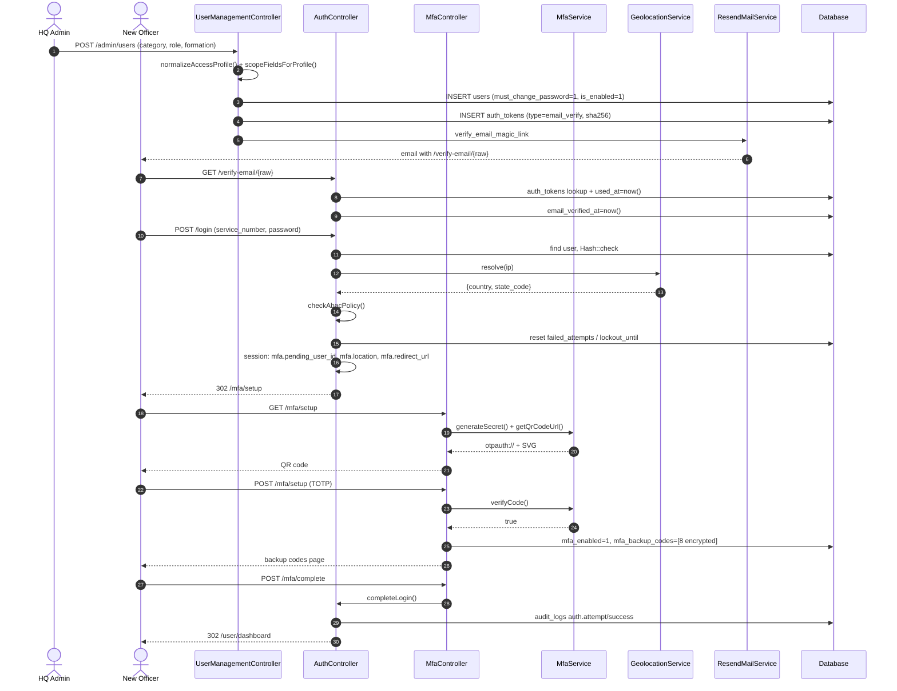
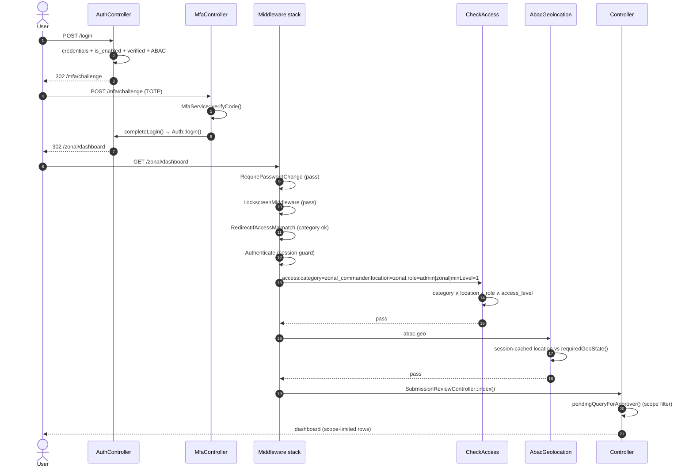
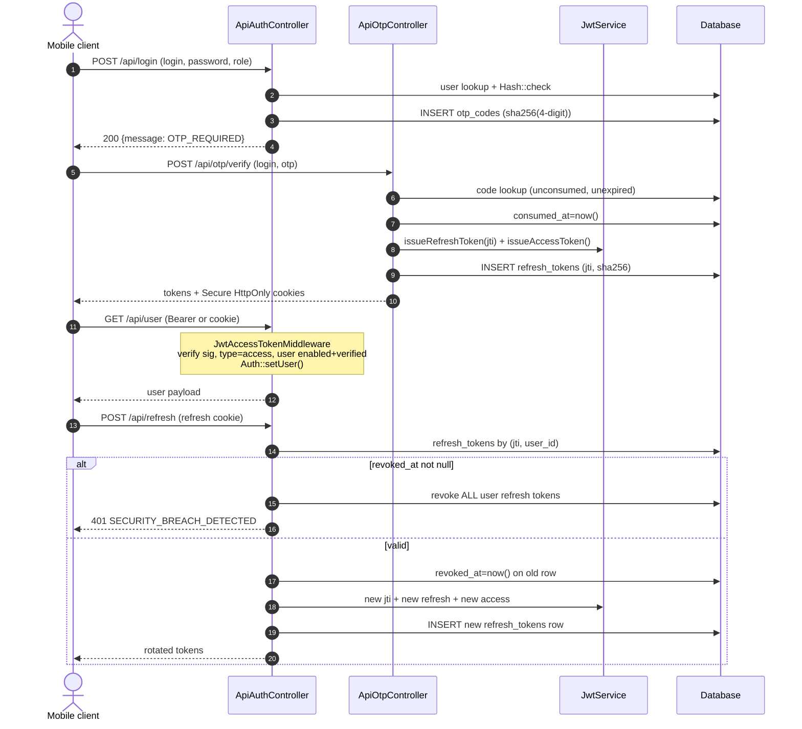

# Authentication & Authorization Workflow — NIS-REDAS

**Scope:** every authentication and authorization code path in the application, the
component that executes each stage, and the full dependency chain (third-party
packages + internal classes) behind it.

**Verified against:** `routes/web.php`, `routes/api.php`, `bootstrap/app.php`,
`config/auth.php`, `config/sanctum.php`, `config/session.php`, `app/Http/**`,
`app/Services/**`, `app/Models/**`, `database/migrations/**`, `.env.example`.

---

## 1. Executive summary

REDAS runs **two entirely separate authentication systems** over one shared `users` table:

| Track | Used by | Credential | Second factor | Session artefact |
|---|---|---|---|---|
| **Web (portal)** | Blade UI — all human users | email **or** `service_number` + password | TOTP MFA (`pragmarx/google2fa`) | Laravel session (database driver) |
| **JSON API (`/api/*`)** | mobile/PWA clients | email **or** `service_number` + password | 4-digit OTP emailed via Resend; enrolled TOTP/backup code if MFA enabled | Sanctum access token + opaque refresh token (HttpOnly cookies) |

The two tracks **never share state**: the API never calls `Auth::login()`, and the web
portal never issues JWTs. Both terminate at the same `App\Models\User`.

Authorization is **100 % middleware + in-controller checks**. There is **no Gate, no
Policy, no `$user->can()`** anywhere in `app/` (verified by search). Four stacked
layers enforce access, in this order:

1. `auth` — is there an authenticated principal? (`Illuminate\Auth\Middleware\Authenticate`)
2. `redirect.access` — friendly bounce for the wrong *account category* (web only)
3. `access:…` — deny-by-default RBAC: **category + location type + role + access level**
4. Resource-level checks inside controllers — record ownership, workflow stage, and operational scope

A fifth, orthogonal layer — **ABAC geolocation** (`abac.geo`) — ties an account to a
Nigerian state and re-validates the caller's IP-derived state on every request.

---

## 2. The authorization vocabulary

Authorization is not built on a single "role" string. It is a **4-tuple** stored on
`users` and read by `App\Models\User` helpers.

| Column | Meaning | Allowed values (from `User` consts) |
|---|---|---|
| `user_category` | **Primary authorization discriminator.** Which portal the account belongs to. | `ACCESS_CATEGORIES`: `state_user`, `desk_admin`, `directorate_user`, `directorate_admin`, `zonal_user`, `zonal_commander`, `cgis_unit_user`, `cgis_desk_admin`, `hq_admin`, `admin`, `super_admin` |
| `primary_location_type` | Where the account works. | `LOCATION_TYPES`: `state`, `zonal`, `directorate`, `unit`, `headquarters` |
| `role` | Coarse legacy role, kept for compatibility. | `ROLE_TYPES`: `user`, `officer`, `admin`, `state`, `zonal`, `directorate`, `unit_officer`, `unit_admin`, `hq_admin`, `super_admin` |
| `access_level` | Numeric seniority, compared with `>=` via `minLevel=`. | `0`–`7` |

### 2.1 Category → role → location → level mapping (canonical)

Both provisioning paths (`AuthController::normalizeAccessProfile()` and
`Admin\UserManagementController::normalizeAccessProfile()`) normalise input to this
table — the second is the only live path today.

| `user_category` | canonical `role` | `primary_location_type` | `access_level` | Portal |
|---|---|---|---|---|
| `state_user` | `officer` | `state` | 0 | State Officer |
| `desk_admin` | `state` | `state` | 1 | State Desk Admin |
| `zonal_user` | `officer` | `zonal` | 0 | Zonal User |
| `directorate_user` | `directorate` | `directorate` | 0 | Directorate |
| `cgis_unit_user` | `unit_officer` | `unit` | 0 | CGIS Unit |
| `cgis_desk_admin` | `unit_admin` | `unit` | 2 | CGIS Desk Admin |
| `directorate_admin` | `admin` | `directorate` | 3 | Directorate Admin |
| `zonal_commander` | `zonal` | `zonal` | 4 | Zonal Command |
| `hq_admin` | `admin` | `headquarters` | 5 | HQ Admin |
| `admin` | `admin` | `headquarters` | 5 | HQ Administration (view-only) |
| `super_admin` | `admin` | `headquarters` | 6 | Executive |
| `executive` (registration only) | `cgis` | `headquarters` | 7 | — |

`User::ACCESS_CATEGORIES` contains `super_admin` but **not** `executive`;
`CheckAccess` rejects any `category=` token not present in that constant
(`strict validation`), so an `executive` account cannot pass `access:` checks.
This is a latent dead-end for that category.

### 2.2 Scope descriptors (used by resource-level authorization)

Beyond the 4-tuple, provisioning writes operational scope columns that drive the
submission workflow (`UserManagementController::scopeFieldsForProfile()`):

| Column | Written for | Derivation |
|---|---|---|
| `assigned_state_code` | `state_user`, `desk_admin` | `geo_state ?: primary_location_code` |
| `assigned_zonal_command_code` | state accounts, `zonal_user`, `zonal_commander` | `NisFormationService::zoneForState()` / `normalizeZoneCode()` |
| `assigned_directorate_code` | `directorate_user`, `directorate_admin` | uppercase 3-letter code (`HRM`, `PRS`, `FIN`, …) |
| `assigned_cgis_unit_code` | `cgis_unit_user`, `cgis_desk_admin` | unit slug (`actu`, `provost`, `servicom`, …) |
| `geo_state` | state accounts | `NisFormationService::geoStateForCode()` |

Read back through `User::directorateSlug()`, `User::cgisUnitSlug()`,
`SubmissionWorkflow::scopeCodeForUser()`, `SubmissionWorkflow::scopeCodeForApprover()`.

---

## 3. Dependencies — what actually runs each stage

### 3.1 Third-party packages (`composer.json`)

| Package | Version constraint | Used by | Role in auth |
|---|---|---|---|
| `laravel/framework` | `^12.0` | everything | Session guard, `Authenticate`, `guest`, `throttle`, `signed`, CSRF, hashing, middleware pipeline |
| `laravel/sanctum` | `^4.3` | `App\Services\TokenService`, `ApiAccessTokenMiddleware`, `User::HasApiTokens` | Issues short-lived, revocable access tokens stored hashed in `personal_access_tokens` |
| `pragmarx/google2fa` | `*` | `App\Services\MfaService` | TOTP secret generation + `verifyKey()` with 1-step drift |
| `bacon/bacon-qr-code` | `*` | `App\Services\MfaService::renderQrCodeSvg()` | Renders the `otpauth://` URI as SVG for the enrolment screen |
| `resend/resend-php` | `0.11` | transitively via `MAIL_MAILER` + `config/services.php` | Delivery of OTP and magic-link mail |
| `hashids/hashids` | `*` | `App\Services\HashidService` | Opaque `{applicationHash}` / `{userHash}` route keys (defence-in-depth against IDOR enumeration, not an auth control) |
| `predis/predis` | `^3.7` | `CACHE_STORE=redis` | Backing store for `RateLimiter` (throttling) and `SettingService` cache |
| `barryvdh/laravel-dompdf` | `*` | `ReportPdfService` | Signed PDF downloads (post-authorization) |

### 3.2 Internal components and the stage each one owns

| Stage | Executed by |
|---|---|
| Account provisioning | `Admin\UserManagementController::store()` |
| Email-verification token mint | `AuthController::register()`, `UserManagementController::sendVerificationEmail()`, `AuthTokenController::createToken()` |
| Email verification consume | `AuthTokenController::verifyEmail()` |
| Web credential check | `AuthController::login()` |
| Brute-force throttle (speculative) | `AuthController::login()` → `RateLimiter` |
| Brute-force lockout (persistent) | `AuthController::login()` → `users.failed_attempts` / `users.lockout_until` |
| Login-time geo/ABAC gate | `AuthController::checkAbacPolicy()` + `GeolocationService::resolve()` |
| MFA enrolment | `MfaController::setup()`, `verifySetup()` |
| MFA challenge | `MfaController::challenge()`, `verifyChallenge()`, `recovery()`, `verifyRecovery()` |
| TOTP/backup-code verification | `MfaService::verifyCode()` |
| Session establishment | `AuthController::completeLogin()` → `Auth::login()` |
| Session heartbeat | `POST /session/keep-alive` |
| Forced password rotation | `RequirePasswordChange` → `ProfileController::update()` |
| Idle lock | `LockscreenController::lock/unlock` + `LockscreenMiddleware` |
| Per-request auth | `Illuminate\Auth\Middleware\Authenticate` |
| Category pre-filter | `RedirectIfAccessMismatch` |
| RBAC evaluation | `CheckAccess` |
| ABAC re-check | `AbacGeolocationMiddleware` |
| Special-command gate | `EnsureSpecialCommand` + `NisFormationService::isSpecialCommandCode()` |
| Record ownership | `Web\DashboardController` (`abort_unless($application->user_id === …)`) |
| Workflow-scope authorization | `SubmissionReviewController::authorizeView/authorizeAction/authorizeScope()` + `SubmissionWorkflow::stageForApprover/scopeCodeForApprover` |
| API credential check + OTP issue | `ApiAuthController::login()` |
| OTP issue/verify | `ApiOtpController::request()`, `verify()` |
| Access token mint | `TokenService::issueAccessToken()` (Sanctum) |
| Access token verify per request | `ApiAccessTokenMiddleware` |
| Refresh token mint / rotation | `TokenService::issueRefreshToken()` / `rotateRefreshToken()` |
| Refresh rotation / reuse detection | `ApiAuthController::refresh()` |
| API logout / revocation | `ApiAuthController::logout()` |
| Audit trail | `AuditLogger` (+ `LogSuspiciousActivity`) |
| Security headers / CSP | `SecurityHeaders` |
---

## 4. Web authentication — stage by stage

The web flow is a **four-gate funnel**. No session principal exists until gate 4.

```
Gate 1  credentials + enabled + verified + geo      → AuthController::login()
Gate 2  second factor (TOTP or recovery code)       → MfaController::verifyChallenge()
Gate 3  session creation                            → AuthController::completeLogin()
Gate 4  per-request authorization                   → middleware stack
```

The intermediate state between gates 1 and 3 lives **only in the session** under
`mfa.pending_*` keys. `Auth::login()` is not called until gate 3, so a half-authenticated
browser holds no guard principal and cannot reach any `auth`-protected route.

### 4.0 Provisioning (how accounts come into existence)

Self-service registration is **disabled at the route level**:

```php
Route::get('/register', fn () => redirect()->route('login')
    ->with('status', 'User registration is now managed by HQ administrators. …'))
    ->name('register');
```

`AuthController::register()` still exists (and still validates + mints a verification
token) but is unreachable from `routes/web.php`.

The live path is **`GET/POST /admin/users`**, mounted only for `hq_admin`:

```php
Route::middleware([Authenticate::class,
    'access:category=hq_admin,location=headquarters,role=admin|minLevel=5',
    'abac.geo'])->group(function () {
        Route::post('/admin/users', [UserManagementController::class, 'store'])…
    });
```

`UserManagementController::store()` runs, in order:

1. `userValidationRules()` — `service_number` must match `/^NIS\/[A-Z]{2,3}\/\d{3,4}$/`,
   email unique, password ≥ 8 + confirmed.
2. `normalizeAccessProfile()` — validates that `(user_category, role, primary_location_type)`
   is a legal combination and returns the canonical triple + `access_level`.
   Illegal combinations throw `ValidationException`.
3. `resolveFormation()` — maps the JSON formation picker's `formation_code` to
   `primary_location_code` and `geo_state` via `NisFormationService`.
4. `scopeFieldsForProfile()` — derives `assigned_state_code`,
   `assigned_zonal_command_code`, `assigned_directorate_code`, `assigned_cgis_unit_code`.
5. `User::create()` with **`must_change_password = true`** and `is_enabled` from the form.
6. `sendVerificationEmail()` — creates an `auth_tokens` row (`type = email_verify`,
   `token_hash = sha256(raw)`, TTL `AUTH_TOKEN_TTL_SECONDS`, default 3600) and emails
   `APP_URL . '/verify-email/' . $rawToken` through `ResendMailService::sendFromTemplate('verify_email_magic_link', …)`.

### 4.1 Gate 0 — Email verification (magic link)

| Route | Handler | Middleware |
|---|---|---|
| `GET /verify-email/{token}` | `AuthTokenController::verifyEmail()` | `guest` |
| `POST /verify-email/resend` | `AuthTokenController::resendVerificationEmail()` | `guest`, `throttle:5,1` |
| `GET /password/reset/{token}` | `AuthTokenController::showResetForm()` | `guest` |
| `POST /password/reset/{token}` | `AuthTokenController::resetPassword()` | `guest`, `throttle:10,1` |
| `GET /password/forgot` | `AuthTokenController::showForgotForm()` | `guest` |
| `POST /password/forgot` | `AuthTokenController::requestPasswordReset()` | `guest`, `throttle:10,1` |

`consumeTokenOrFail()` is the single consumer for both `email_verify` and
`password_reset`:

- validates length ≥ 16;
- looks up `auth_tokens` by `type`, `token_hash = sha256($raw)`, `used_at IS NULL`,
  `expires_at > now()`, newest first;
- **sets `used_at = now()`** → single use, immediately burned.

`verifyEmail()` then sets `email_verified_at = now()` and redirects to `login`.

Both `resendVerificationEmail()` and `requestPasswordReset()` return an **identical
generic response** whether or not the account exists (anti-enumeration).

> **Note:** Laravel's own `password_reset_tokens` table and the `passwords` broker in
> `config/auth.php` are **unused** — password reset is fully custom via `auth_tokens`
> and `AuthTokenController`.

### 4.2 Gate 1 — Credential check (`AuthController::login`)

Route: `POST /login` → `AuthController::login`, middleware `guest` + `throttle:10,1`.

Execution order inside the method:

1. **Validation** — accepts either `username` or `login` (mutually `required_without`).
2. **Field inference** — `filter_var($input, FILTER_VALIDATE_EMAIL)` decides
   `email` vs `service_number`. Email is lower-cased; service number upper-cased.
3. **Speculative throttle** — key `lower(login)|ip`; `MAX_LOGIN_ATTEMPTS = 5`,
   `LOCKOUT_SECONDS = 60` (`RateLimiter::tooManyAttempts` → `ValidationException`).
4. **User lookup** — `LOWER(email) = ?` or `service_number = ?` (case-normalised).
5. **Persistent lockout check** — if `lockout_until` is in the future, reject with the
   remaining seconds. (`lockout_until` is set for **15 minutes** after 5 failures.)
6. **Password check** — `Hash::check()` against the bcrypt/argon hash (`password` cast is
   `hashed`). Failure → `RateLimiter::hit()`, `increment('failed_attempts')`, and at
   `>= 5` sets `lockout_until = now()+15min` and resets the counter, then
   `AuditLogger::logAuthAttempt(status:'failure', reason:'invalid_credentials')`.
7. **`is_enabled === false`** → audited `reason:'account_disabled'` → rejected.
8. **`email_verified_at` is null** → audited `reason:'email_not_verified'` → rejected,
   and flashes `unverified_login` so the login page can offer a resend link.
9. **ABAC geolocation** → `checkAbacPolicy($user, GeolocationService::resolve($ip))`.
   On denial: `AuditLogger::logAuthBlocked()`, record the attempt, reject.
10. **Success bookkeeping** — `RateLimiter::clear()`, reset `failed_attempts`/`lockout_until`.

Only after all ten steps does it write the pending-MFA session state and redirect:

```php
$request->session()->put('mfa.pending_user_id', $user->id);
$request->session()->put('mfa.location',      $location);
$request->session()->put('mfa.remember',      $request->boolean('remember'));
$request->session()->put('mfa.redirect_url',  $this->getRedirectUrl($user));

return $user->isMfaEnabled()
    ? redirect()->route('mfa.challenge')
    : redirect()->route('mfa.setup');     // first login → forced enrolment
```

#### The ABAC check (`AuthController::checkAbacPolicy`)

Short-circuits to *allow* when any of these hold (all `SettingService` rows in `settings`):

| Setting | Default | Effect when hit |
|---|---|---|
| `abac_enabled` | `true` | `false` → allow everything |
| `abac_location_enforcement` | `true` | `false` → allow everything |
| `abac_hq_bypass` | `false` | `true` **and** `User::isHeadquartersUser()` → allow |

Otherwise:

- `User::requiredGeoState()` returns `null` for `directorate`/`unit` accounts (non-geographic)
  → allow. For `state` accounts it is `geo_state`, falling back to `primary_location_code`.
- The detected **country** must be in `abac_allowed_countries` (default `Nigeria`).
- The detected **state code** must equal `requiredGeoState()` exactly.
- Otherwise: `reason: 'Login attempt from outside allowed country.'` or
  `'Login attempt from outside required state.'`

`GeolocationService::resolve($ip)`:

- private/loopback IP → returns the configured `geolocation_fallback_state` (default `FC`);
- otherwise `Cache::remember('geoip.'.md5($ip), geolocation_cache_ttl)` around either
  `ip-api.com` or `ipapi.co` (chosen by `geolocation_provider`, token from
  `geolocation_api_token`);
- provider failure → `country: 'Unknown'` + fallback state, which will **fail** the
  country check. Failure is therefore fail-closed for state accounts.

### 4.3 Gate 2 — MFA (`MfaController`)

All MFA routes are gated by `RequireMfaPending` (alias `mfa.pending`), which only checks
that `session('mfa.pending_user_id')` resolves to a real `User`; otherwise it clears the
keys and redirects to `login`.

| Route | Method | Behaviour |
|---|---|---|
| `GET /mfa/setup` | `setup()` | If already enabled → challenge. Else generate/keep `mfa_secret`, build `otpauth://` URI via `MfaService::getQrCodeUrl()`, render SVG QR via BaconQrCode, show `mfa.setup`. |
| `POST /mfa/setup` | `verifySetup()` | `MfaService::verifyCode()`; on success sets `mfa_enabled = true`, `mfa_verified_at = now()`, `mfa_backup_codes = generateBackupCodes(8)`, sets `session('mfa.setup_verified')`, shows `mfa.backup-codes`. |
| `POST /mfa/complete` | `complete()` | Requires `mfa.setup_verified`, then delegates to `AuthController::completeLogin()`. |
| `GET /mfa/challenge` | `challenge()` | If not enabled → setup; else `mfa.challenge` view. |
| `POST /mfa/challenge` | `verifyChallenge()` | `MfaService::verifyCode()` → `completeLogin()`. |
| `GET /mfa/recovery` | `recovery()` | `mfa.recovery` view. |
| `POST /mfa/recovery` | `verifyRecovery()` | Same verifier; backup codes are single-use. |
| `POST /mfa/cancel` | `cancel()` | Forgets all `mfa.*` session keys → `login`. |

`MfaService::verifyCode(User $user, string $code)`:

1. strip whitespace; empty → false;
2. `mfa_secret` empty → false;
3. **6-digit numeric** → `Google2FA::verifyKey($secret, $code, 1)` (1 window of drift);
4. otherwise → `verifyBackupCode()`: exact `array_search` in `mfa_backup_codes`,
   then `array_splice` the code out and persist (`null` when the list empties);
5. on success `mfa_last_used_at = now()`.

`mfa_secret` is cast `encrypted`; `mfa_backup_codes` is cast `encrypted:array` — both are
AES-encrypted at rest with `APP_KEY` and hidden from serialization.

### 4.4 Gate 3 — Session creation (`AuthController::completeLogin`)

```php
Auth::login($user, $remember);                       // guard 'web', provider 'users'
$request->session()->forget(['mfa.pending_user_id','mfa.location',
                             'mfa.remember','mfa.redirect_url','mfa.setup_verified']);
$request->session()->put('abac.location', $location);
$request->session()->put('abac.resolved_at', now());
AuditLogger::logAuthAttempt($user, 'success', […detected state/country…]);
```

Redirect target is `session('mfa.redirect_url')`, produced by `AuthController::getRedirectUrl()`
(mirrored by `User::homeRoute()` and `LockscreenController::redirectUrlForUser()`):

| `user_category` | Landing URL |
|---|---|
| `super_admin` | `/superadmin/dashboard` |
| `admin`, `hq_admin` | `/admin/dashboard` |
| `zonal_commander` | `/zonal/dashboard` |
| `desk_admin`, `directorate_admin`, `cgis_desk_admin` | `/desk-admin/dashboard` |
| `directorate_user` | `/user/directorates/dashboard` |
| `cgis_unit_user` | `/user/cgis-units/dashboard` |
| `state_user` | `/user/dashboard` |
| `zonal_user` | `/user/zones/dashboard` |
| `special_command_user` | `/special-commands/dashboard` |

If `must_change_password` is true, the redirect is overridden to `user.profile` — and
`RequirePasswordChange` will keep forcing them there on every subsequent request.

### 4.5 Lockscreen (orthogonal to auth)

| Route | Handler | Middleware |
|---|---|---|
| `GET /lockscreen` | `LockscreenController::show()` | `auth` |
| `POST /lockscreen/lock` | `lock()` | `auth` |
| `POST /lockscreen/unlock` | `unlock()` | `auth` |

- `lock()` sets `session('session.locked', true)`; returns JSON for AJAX (idle timer) or a
  redirect for form posts.
- `LockscreenMiddleware` (in the `web` group) redirects **every** request to
  `lockscreen.show` while locked, storing `url.intended` for GET navigations.
- `unlock()` accepts `lockscreen_passcode` (bcrypt, set from the profile page) and falls
  back to the **account password** if no passcode is configured. Success clears the flag
  and redirects to `redirect()->intended()`.

### 4.6 Password rotation & change

`POST|PATCH /user/profile` → `ProfileController::update()` with `section=password`
requires `current_password` (verified with `Hash::check`) and a new `password`
(`min:8`, `confirmed`). On success: `must_change_password = false`.

`RequirePasswordChange` (first in the appended `web` group) intercepts any request from a
user with `must_change_password = true`, except `user.profile`, `user.profile.update` and
`logout`:

```php
private const EXEMPT_ROUTES = ['user.profile', 'user.profile.update', 'logout'];
```

### 4.7 Logout

`POST /logout` → `AuthController::logout()`, middleware `throttle:database`:

```php
AuditLogger::logLogout($user, $ip);
Auth::logout();
$request->session()->invalidate();     // new session id + flush
$request->session()->regenerateToken();// new CSRF token
```

Session ID rotation on logout plus `invalidate()` means a stolen cookie is dead after
logout. `POST /session/keep-alive` (`auth`) exists purely so long forms do not hit a 419.
---

## 5. Gate 4 — the per-request authorization pipeline

### 5.1 Middleware registration (`bootstrap/app.php`)

**Aliases**

| Alias | Class |
|---|---|
| `role` | `App\Http\Middleware\CheckRole` |
| `access` | `App\Http\Middleware\CheckAccess` |
| `abac.geo` | `App\Http\Middleware\AbacGeolocationMiddleware` |
| `mfa.pending` | `App\Http\Middleware\RequireMfaPending` |
| `lockscreen` | `App\Http\Middleware\LockscreenMiddleware` |
| `redirect.access` | `App\Http\Middleware\RedirectIfAccessMismatch` |
| `api.token` | `App\Http\Middleware\ApiAccessTokenMiddleware` |
| `session.fingerprint` | `App\Http\Middleware\ValidateSessionFingerprint` |

**Appended to the `web` group** (runs *after* Laravel's defaults — `EncryptCookies`,
`AddQueuedCookiesToResponse`, `StartSession`, `ShareErrorsFromSession`,
`ValidateCsrfToken`, `SubstituteBindings`):

1. `AuthenticateSession` — **conditional**: appended only when
   `SESSION_AUTHENTICATE_SESSION_ENABLED` is true (defaults to true outside
   `local` and `testing`, so `actingAs()` in tests still works).
2. `RequirePasswordChange`
3. `LockscreenMiddleware`
4. `RedirectIfAccessMismatch`
5. `ValidateSessionFingerprint`

**Appended globally** (both `web` and `api`):

6. `LogSuspiciousActivity`
7. `SecurityHeaders`

**Trusted proxies:** `TRUSTED_PROXIES` (comma list), honouring
`X-Forwarded-{For,Host,Port,Proto,Prefix}` + AWS ELB header. This matters because
`GeolocationService` keys off `$request->ip()`, which is proxy-derived.

### 5.2 Effective execution order for a typical protected web page

```
TrustProxies → HandleCors → PreventRequestsDuringMaintenance → ValidatePostSize
→ TrimStrings → ConvertEmptyStringsToNull
→ LogSuspiciousActivity            (global; inspects response on unwind)
→ SecurityHeaders                  (global; sets headers on unwind)
→ EncryptCookies → AddQueuedCookiesToResponse → StartSession
→ ShareErrorsFromSession → ValidateCsrfToken → SubstituteBindings          (web group)
→ AuthenticateSession              (session-fixation / concurrent-session guard; web group)
→ RequirePasswordChange            (must_change_password gate)
→ LockscreenMiddleware             (session.locked gate)
→ RedirectIfAccessMismatch         (category pre-filter, needs route middleware string)
→ ValidateSessionFingerprint       (IP/UA session fingerprint; web group)
→ Authenticate                     (per-route: 'auth')
→ CheckAccess                      (per-route: 'access:…')
→ AbacGeolocationMiddleware        (per-route: 'abac.geo')
→ EnsureSpecialCommand             (only /special-commands/*)
→ Controller method                (resource-level ownership / scope checks)
```

Note the ordering nuance: `RedirectIfAccessMismatch` is a **web-group** middleware, so it
runs **before** `Authenticate`. It is deliberately written with
`if (! $user instanceof User) return $next($request);` so guests fall through to
`Authenticate` and get the normal login redirect.

### 5.3 `RedirectIfAccessMismatch` — friendly redirect, not a security control

It inspects the resolved route's middleware **string** for anything starting with
`access:`, extracts every `category=a|b|c` token, and if the user's `user_category` is not
in that list, redirects to `$user->homeRoute()` with
`'This page is not available for your account type.'`.

If the route has no `access:` middleware it returns `null` and the middleware is a no-op.
It is a UX layer only — the actual denial is `CheckAccess`.

### 5.4 `CheckAccess` — the RBAC engine

Invocation form (comma-split by Laravel into separate `$constraints` arguments):

```
access:category=a|b,location=x|y,role=p|q|minLevel=N
```

`parseConstraints()` builds:

```php
['category' => [...], 'location' => [...], 'role' => [...], 'minLevel' => ?int]
```

It also handles the **crammed** form `role=super_admin|minLevel=6` by detecting the
literal substring `minLevel=` inside a value and splitting it out.

`passesAccessChecks()` — **deny by default**, all populated checks must pass:

1. **category** — every requested category must exist in `User::ACCESS_CATEGORIES`
   (an unknown token fails the whole check), then
   `$user->hasCategory(...$parsed['category'])` (exact `in_array` on `user_category`).
2. **location** — every requested location must exist in `User::LOCATION_TYPES`, then
   `hasLocationType(...)`.
3. **role** — every requested role must be in `User::ROLE_TYPES` **or** the legacy list
   `['admin','zonal','state','officer','directorate','user','hq_admin','super_admin']`.
   Then it expands the request through the legacy alias map and accepts a match on
   **either** path:

   ```php
   $legacyRoleAliases = [
       'user' => 'officer',  'admin' => 'admin',  'state' => 'admin',
       'zonal' => 'admin',   'directorate' => 'user',
       'super_admin' => 'admin', 'executive' => 'cgis', 'hq_admin' => 'admin',
   ];
   $matched = $user->hasRoleType(...$parsed['role'])
           || $user->hasLegacyRole(...$expandedLegacyRoles);
   ```

   This is what lets a `super_admin` (stored `role = 'admin'`, level 6) satisfy
   `role=super_admin|minLevel=6`: direct `hasRoleType('super_admin')` fails, but the alias
   expansion adds `'admin'` and `hasLegacyRole('admin')` succeeds.

4. **minLevel** — `(int) $user->access_level >= $minLevel`.

On failure it returns a **redirect** (302) to `$user->homeRoute()` with an `error` flash —
not a 403. `abort(403)` happens only when there is no `User` at all.

### 5.5 `AbacGeolocationMiddleware` (`abac.geo`)

Runs on every authenticated route group. Cheap because of session caching:

| Session key | Purpose |
|---|---|
| `abac.location` | last resolved `{country,state,state_code,provider}` |
| `abac.resolved_at` | timestamp of resolution |
| `abac.ip` | IP the cache belongs to |

Re-resolves through `GeolocationService::resolve()` only when the IP changed **or**
`RECHECK_SECONDS = 300` elapsed. If `state_code !== requiredGeoState()`:

```php
AuditLogger::logAuthBlocked($user, 'Session request from outside required state.', […]);
abort(403, 'Access denied: your current location is not authorized for this account.');
```

Skips entirely when `abac_enabled` is off, `abac_location_enforcement` is off,
`abac_hq_bypass` is on and the user is HQ, or `requiredGeoState()` is `null`
(directorate/unit accounts are non-geographic).

### 5.6 `ValidateSessionFingerprint` (`session.fingerprint`)

Runs on every authenticated web route after login. Computes a SHA-256 hash of the
client IP + user-agent (truncated to 256 chars) and compares it to the value stored in
session at `AuthController::completeLogin()` under `session.fingerprint`.

- On first protected request without a stored fingerprint, the current fingerprint is
  stored rather than forcing re-auth.
- On mismatch, the session is invalidated, the user is logged out, and the request is
  redirected to `/login` (web) or returns `419` (JSON/API-style requests).
- Exempt routes include auth routes, MFA pending routes, password reset, lockscreen,
  and public pages.
- Skipped when `SESSION_FINGERPRINT_ENFORCED=false`.
- HQ users also skip the check when `abac_hq_bypass` is enabled.

This provides detection of session theft/cookie replay from a different device or network.

### 5.7 `EnsureSpecialCommand`

Used only inside `/special-commands/*`. `403` unless
`NisFormationService::isSpecialCommandCode($user->primary_location_code)` — i.e. the
account is provisioned to one of the hard-coded `SPECIAL_COMMAND_CODES`.

### 5.8 `SecurityHeaders`

Sets `X-Content-Type-Options: nosniff`, `X-Frame-Options: SAMEORIGIN`,
`Referrer-Policy: strict-origin-when-cross-origin`, a restrictive `Permissions-Policy`,
HSTS (`max-age=31536000; includeSubDomains`, skipped in `local`), and a nonce-based CSP
delivered as **`Content-Security-Policy-Report-Only`** (not enforced).
`csp_nonce()` is a `static` per-process random value from `app/helpers.php`, exposed to
Blade via `@nonce`.

### 5.9 `LogSuspiciousActivity`

Wraps every request (global stack). On unwind, if the status is in
`[401, 403, 419, 429]` it writes an `audit_logs` row:
`action = 'security.suspicious_response'`, `status = 'blocked'`, with
`{status, path, method}` and the resolved user.

### 5.10 `CheckRole` (registered, unused)

`abort(403)` unless `in_array($user->role, $roles)`. The alias `role` is registered but
**no route in `routes/web.php` or `routes/api.php` uses it** — all role semantics go
through `access:`.

---

## 6. Route → authorization matrix

Every group below is exactly as declared in `routes/web.php`.

| # | Route group (prefix) | `auth` | `access:` constraint | `abac.geo` | Extra |
|---|---|---|---|---|---|
| 1 | `/` `/home` `/terms-and-conditions` `/privacy-policy` `/directory` | — | — | — | public |
| 2 | `POST /session/keep-alive` | ✔ | — | — | — |
| 3 | `GET/POST /login`, `/password/*`, `/verify-email/*`, `GET /register` | — | — | — | `guest` (+ throttle) |
| 4 | `/lockscreen*` | ✔ | — | — | — |
| 5 | `/user/*` (state officer) | ✔ | `category=state_user, location=state, role=user\|officer\|minLevel=0` | ✔ | — |
| 6 | `/user/notifications*`, `/user/archive*`, `/user/reports*` | ✔ | — | ✔ | shared by all roles |
| 7 | `/user/profile`, `/user/submissions/{hash}/pdf` | ✔ | — | — | `signed` on PDF |
| 8 | `/user/zones/*` (zonal officer) | ✔ | `category=zonal_user, location=zonal, role=user\|officer\|minLevel=0` | ✔ | — |
| 9 | `/special-commands/*` | ✔ | `category=state_user, location=state, role=user\|officer\|minLevel=0` | ✔ | `EnsureSpecialCommand` |
| 10 | `/zonal/*` (zonal commander) | ✔ | `category=zonal_commander, location=zonal, role=admin\|zonal\|minLevel=1` | ✔ | — |
| 11 | `/desk-admin/*` (desk / directorate / CGIS / HQ review) | ✔ | `category=desk_admin\|directorate_admin\|cgis_desk_admin\|hq_admin, location=state\|directorate\|unit\|headquarters, role=admin\|state\|directorate\|unit_admin\|minLevel=1` | ✔ | — |
| 12 | `/user/cgis-units/*` | ✔ | `category=cgis_unit_user, location=unit\|headquarters, role=user\|officer\|unit_officer\|minLevel=0` | ✔ | — |
| 13 | `/user/directorates/*` (user + admin) | ✔ | `category=directorate_user\|directorate_admin, location=directorate, role=user\|admin\|directorate\|minLevel=0` | ✔ | — |
| 14 | `/user/directorates/{slug}` POST/GET (shared) | ✔ | `category=state_user\|directorate_user\|directorate_admin, location=state\|directorate, role=user\|admin\|officer\|directorate\|minLevel=0` | ✔ | slug re-checked in controller |
| 15 | `/superadmin/*` | ✔ | `category=super_admin, location=headquarters, role=super_admin\|minLevel=6` | ✔ | — |
| 16 | `/cgis/executive-dashboard`, `/cgis/data-explorer` | ✔ | `category=cgis_unit_user\|cgis_desk_admin\|super_admin\|admin, location=unit\|headquarters, role=unit_officer\|unit_admin\|admin\|super_admin\|minLevel=0` | ✔ | — |
| 17 | `/dashboard/state`, `/dashboard/zonal`, `/supervisor/dashboard` | ✔ | `category=desk_admin\|zonal_commander, location=state\|zonal, role=admin\|state\|zonal\|minLevel=1` | ✔ | — |
| 18 | `/admin/dashboard`, `/admin/hq/*`, `/admin/consolidation` | ✔ | `category=hq_admin\|admin, location=headquarters, role=admin\|minLevel=5` | ✔ | **read-only tier** |
| 19 | `/admin/submissions*`, `/admin/settings`, `/admin/audit-log`, `/admin/users*` | ✔ | `category=hq_admin, location=headquarters, role=admin\|minLevel=5` | ✔ | **mutating tier** |
| 20 | `/mfa/*` | — | — | — | `mfa.pending` |
| 21 | `POST /logout` | — | — | — | `throttle:database` |

**The `admin` vs `hq_admin` split is the key separation of duties on the web tier:**
`admin` (National Administrator, level 5) can *view* dashboards, returns, archive,
analytics, reports and consolidation, but every mutating route (approve/reject, settings,
audit log, user management) requires `category=hq_admin` specifically.

---

## 7. Resource-level authorization (inside controllers)

Middleware answers *"may this class of user reach this URL?"*. It cannot answer
*"may this user touch this row?"*. Three patterns cover that.

### 7.1 Ownership — submitter routes (`Web\DashboardController`, `ZonalUserController`, `SpecialCommandController`)

Every submitter endpoint resolves the hashed id through
`Concerns\ResolvesHashedModels` and then hard-checks the owner:

```php
abort_unless($application->user_id === $request->user()->id, 403);
```

Applied in `showSubmission`, `printSubmission`, `submissionDocument`,
`editSubmission`, `updateSubmission`. Deletion uses the domain rule instead of raw
ownership:

```php
abort_unless($user !== null && SubmissionWorkflow::deletableBy($application, $user), 403);

// SubmissionWorkflow::deletableBy
return $application->user_id === $user->id
    && $application->status !== 'approved';
```

`downloadSubmissionPdf()` additionally allows in-scope approvers
(`$isOwner || $isApprover`).

Unhashed-or-forged ids fail at `HashidService::decode()` → 404, so IDs are not
enumerable and never trusted as an authorization signal on their own.

### 7.2 Workflow stage + operational scope — reviewer routes (`SubmissionReviewController`)

```php
private function authorizeAction(Application $application, User $user): void
{
    $requiredStage = SubmissionWorkflow::stageForApprover($user);
    if ($requiredStage === null)                        abort(403, 'Unauthorized action.');
    if ($application->workflow_stage !== $requiredStage) abort(403, 'This submission is not awaiting your review.');
    $this->authorizeScope($application, $user);
}

private function authorizeView(Application $application, User $user): void
{
    $isReviewer = SubmissionWorkflow::stageForApprover($user) !== null;
    $isHqViewer = $user->hasCategory('admin','super_admin') && $user->hasLocationType('headquarters');
    if (! $isReviewer && ! $isHqViewer)                  abort(403, 'Unauthorized.');
    $this->authorizeScope($application, $user);
}

private function authorizeScope(Application $application, User $user): void
{
    $scopeCode = SubmissionWorkflow::scopeCodeForApprover($user);
    if ($scopeCode !== null && $applicationScope !== $scopeCode) {
        abort(403, 'This submission is outside your provisioned scope.');
    }
}
```

Both `authorizeAction` **and** `authorizeView` are called on `approve`/`reject`; the
`show`/`document`/`download` paths call only `authorizeView`.

`SubmissionWorkflow::stageForApprover()` fixes each reviewer category to exactly one stage:

| `user_category` | Stage owned |
|---|---|
| `desk_admin` | `desk_review` |
| `zonal_commander` | `zonal_review` |
| `directorate_admin` | `directorate_review` |
| `cgis_desk_admin` | `cgis_desk_review` |
| `hq_admin` | `hq_review` |
| everything else | `null` → cannot review anything |

`scopeCodeForApprover()` fixes each reviewer to a scope key:

| `user_category` | Scope source |
|---|---|
| `desk_admin` | `primary_location_code ?: assigned_state_code` |
| `directorate_admin` | `User::directorateSlug()` |
| `cgis_desk_admin` | `User::cgisUnitSlug()` |
| `zonal_commander` | `NisFormationService::normalizeZoneCode(primary_location_code ?: assigned_zonal_command_code)` |

`pendingQueryForApprover()` and `reportQuery()` apply the same scope to the **queue**,
so a reviewer cannot even see out-of-scope rows. `zonal_commander` matches on
`UPPER(REPLACE(zonal_code,'_','-'))` with a `scope_code` fallback when `zonal_code` is
null. `approve()` re-derives `zonal_code` for desk-admin approvals so the row lands in the
correct zonal queue.

Lifecycle enforced by the stage machine (`nextStageFromStage`):

```
submitted → desk_review      → zonal_review → hq_review → approved
          → directorate_review →             hq_review → approved
          → cgis_desk_review   →             hq_review → approved
          → zonal_review       →             hq_review → approved
reject() at any stage → workflow_stage = submitted, status = returned
```

### 7.3 Formation-slug confinement (`DashboardController`)

`storeDirectorate()` and `storeCgisUnit()` compare the `{slug}` in the URL against the
user's own assignment:

```php
abort(403, 'You are not authorised to submit this directorate return.');   // line 352
abort(403, 'You are not authorised to submit this CGIS unit return.');     // line 491
```

This is what stops a `directorate_user` from posting an `hrm` form while holding a `prs`
account — the route group (row 14 above) intentionally allows both state and directorate
accounts, so the controller carries the confinement.

### 7.4 Signed URLs

Document/PDF/report/download routes add `signed`:
`/user/submissions/{hash}/pdf`, `*.destroy`, `*.document`, `*.download`, and all
approve/reject `PATCH` routes. Combined with `auth`, a leaked link is only valid for the
temporary-signature window and only for a logged-in principal.
---

## 8. API authentication (Sanctum + OTP) — stage by stage

All API routes are wrapped in `Route::middleware('throttle:api')` (60/min keyed by user id
or IP, defined in `AppServiceProvider::boot()`). The API group is stateless: no session,
no CSRF, no `Auth::login()`.

```
POST /api/login        → credentials → mint+email OTP → "OTP_REQUIRED" (no token yet)
POST /api/otp/verify   → OTP (+ enrolled TOTP/backup code if MFA enabled) → issue Sanctum access + opaque refresh
POST /api/refresh      → refresh cookie → rotate → new access + refresh
POST /api/logout       → refresh cookie + access token → revoke → clear cookies
```

### 8.1 `POST /api/login` → `ApiAuthController::login()` (`throttle:10,1`)

1. Validate `login` (string) and `password` (string).
2. Infer the lookup column from the `login` value (`email` lower-cased, else `service_number`).
3. `User::where([$field => $normalized])->first()`.
4. `Hash::check()` failure or no user → `401` `"The provided credentials are incorrect."`
5. `is_enabled === false` → `403` `"ACCOUNT_DISABLED"`.
6. `email_verified_at` null → `403` `"EMAIL_NOT_VERIFIED"`.
7. Generate a **4-digit** code:
   `str_pad(random_int(0,9999), 4, '0', STR_PAD_LEFT)`, store
   `OtpCode::create([... 'code_hash' => hash('sha256', $otp), 'expires_at' => now()+OTP_TTL_SECONDS, 'attempts' => 0])`.
8. Email it through `ResendMailService::sendFromTemplate('otp_login', …)`. Delivery
   failure → `502` (the OTP row stays, but is unusable without the mail).
9. Respond `200 { message: 'OTP_REQUIRED', expires_at, purpose: 'login' }` — **no token yet.**

### 8.2 `POST /api/otp/verify` → `ApiOtpController::verify()` (`throttle:10,1`)

1. Validate `login`, `purpose ∈ {login, verify_email}`, `otp` matches `^\d{4}$`, optional `totp` (string, max 32).
2. Resolve the user; `is_enabled === false` → `403 ACCOUNT_DISABLED`.
3. **OTP lockout**: `otp_locked_until` in the future → `403` with `retry_after_seconds`.
4. Look up `otp_codes` by `user_id`, `purpose`, `code_hash = sha256(input)`,
   `consumed_at IS NULL`, `expires_at > now()`, newest first.
5. **No match** → increment `attempts` on the newest active OTP, call
   `recordFailedOtpAttempt()`, then `401 OTP_INVALID` (or the 403 lockout payload).
6. **Match but `attempts >= OTP_MAX_ATTEMPTS` (5)** → `403 OTP_MAX_ATTEMPTS_EXCEEDED`.
7. Consume: `consumed_at = now()`, `attempts++`, `resetOtpLockout()`.
8. If `must_change_password` → `403 PASSWORD_CHANGE_REQUIRED` — the API deliberately
   refuses to issue tokens, because there is no API password-change flow and doing so
   would bypass the forced-rotation policy. The user must use the web portal.
9. **MFA enforcement**: if `$user->isMfaEnabled()`:
   - missing `totp` → `401 { message: 'MFA_REQUIRED', methods: ['totp', 'backup_code'] }`;
   - invalid `totp` → `401 { message: 'MFA_INVALID', methods: ['totp', 'backup_code'] }`;
   - valid TOTP or single-use backup code → continue (backup codes are consumed).
10. Otherwise mint the pair:
   - `accessToken = TokenService::issueAccessToken($user)` → Sanctum personal access token
     with ability `access`, stored hashed in `personal_access_tokens`;
   - `refreshToken = TokenService::issueRefreshToken($user, $request)` → 64-byte opaque token,
     persisted in `refresh_tokens` with `jti` (uuid), `token_hash = sha256(token)`,
     `expires_at = now()+SANCTUM_REFRESH_TTL`, `created_ip`, `user_agent`;
   - return the tokens in the body **and** as `Secure; HttpOnly; SameSite=Strict` cookies
     (`access_token`, `refresh_token`) via `AuthCookie::make()`.

`recordFailedOtpAttempt()` is a **per-user** counter (`users.otp_failed_attempts`), not
per-code: at `OTP_MAX_ATTEMPTS` (5) it zeroes the counter and sets
`otp_locked_until = now() + OTP_LOCKOUT_MINUTES` (**15**), logging
`'OTP account locked after max attempts'`.

`POST /api/otp/request` (`throttle:5,1`) is the standalone resend endpoint; it applies the
same lockout check before minting a fresh row (old rows are left to expire, not revoked —
lookups always order by `created_at DESC` and require `consumed_at IS NULL`).

### 8.3 Access token structure and lifetime (`TokenService`)

Access tokens are **Laravel Sanctum** personal access tokens:

| Attribute | Value |
|---|---|
| name | `api-access` |
| abilities | `["access"]` |
| expires_at | `now() + SANCTUM_ACCESS_TTL` (default **900 s**) |
| storage | hashed in `personal_access_tokens` (SHA-256 of the plain token) |

Refresh tokens are **opaque**, not JWTs:

| Attribute | Value |
|---|---|
| value | 64 cryptographically random bytes, hex-encoded |
| storage | SHA-256 hash in `refresh_tokens` |
| lifetime | `SANCTUM_REFRESH_TTL` (default **30 days**) |
| metadata | `created_ip`, `user_agent`, `jti` (uuid) |

| Env | `.env.example` | Meaning |
|---|---|---|
| `SANCTUM_ACCESS_TTL` | `900` | access token lifetime (s) |
| `SANCTUM_REFRESH_TTL` | `2592000` | refresh token lifetime (s) |
| `SANCTUM_STATEFUL_DOMAINS` | local dev hosts | SPA cookie domains |
| `SANCTUM_TOKEN_PREFIX` | empty | optional plain-text prefix |

### 8.4 `ApiAccessTokenMiddleware` — per-request API authentication

Order of checks:

1. `Authorization: Bearer <sanctum-token>` header, **else** the `access_token` HttpOnly cookie
   (so a browser/PWA can authenticate without JavaScript touching the token).
2. Missing → `401 TOKEN_INVALID`.
3. `PersonalAccessToken::findToken()` fails → `401 TOKEN_INVALID`.
4. Token expired or ability does not contain `access` → `401 TOKEN_INVALID`.
5. User not found → `401 TOKEN_REVOKED`.
6. `is_enabled === false` → `401 ACCOUNT_DISABLED`.
7. `email_verified_at` null → `401 EMAIL_NOT_VERIFIED`.
8. `Auth::guard('sanctum')->setUser($user)` and `Auth::setUser($user)` — binds the principal
   for `$request->user()` for the rest of the request (session is never involved).

Unlike the previous JWT implementation, Sanctum tokens are **stateful and instantly
revocable**: deleting the row from `personal_access_tokens` immediately invalidates the
token. The middleware also stores the resolved token in `$request->attributes` so logout can
revoke it.

### 8.5 `POST /api/refresh` — rotation with reuse detection

1. Read the opaque refresh token from the `refresh_token` cookie only (never from the body).
   Absent → `401 SESSION_EXPIRED`.
2. Look it up by SHA-256 hash in `refresh_tokens`. Not found → `401 TOKEN_INVALID`.
3. **Reuse detection:** if `revoked_at` is already set, revoke **every** refresh token for
   that user (`where('user_id')->update(['revoked_at' => now()])`) and return
   `401 SECURITY_BREACH_DETECTED`.
4. `expires_at` past → `401 TOKEN_EXPIRED`.
5. **Rotate:** mark the presented row `revoked_at = now()`, mint a new `jti` (uuid), a new
   opaque refresh token, and insert a new `refresh_tokens` row with its sha256 hash, IP and UA.
6. Mint a fresh Sanctum access token for the **current** user (re-read from the DB, so a
   role change takes effect within one access-token lifetime).
7. Return both tokens in the body and re-set both cookies.

Because every refresh burns its predecessor, the only way a valid-but-revoked refresh
token can be presented is theft or replay — hence the full-session revocation on
detection. Detection is global for the user, not per-device, so a breach logs the account
out everywhere.

### 8.6 `POST /api/logout`

Revokes both artefacts:

1. Reads the `refresh_token` cookie and revokes the matching `refresh_tokens` row.
2. Reads the resolved Sanctum access token from the request attributes (set by the
   middleware) and deletes it from `personal_access_tokens`.

Always returns `200` and always clears both cookies (`AuthCookie::forget()`), so a client
can never be stuck logged in.

### 8.7 Protected API surface

| Route | Handler | Authorization |
|---|---|---|
| `GET /api/user` | closure | any valid access token |
| `GET /api/notifications` | `ApiNotificationController::index` | any valid access token |
| `GET /api/notifications/count` | `::count` | any valid access token |
| `POST /api/notifications/mark-all-read` | `::markAllRead` | any valid access token |
| `POST /api/notifications/{id}/read` | `::markRead` | any valid access token |
| `POST /api/logout` | `ApiAuthController::logout` | any valid access token |

There is **no `access:` equivalent on the API tier** — any authenticated token holder can
call any API route. The API surface is intentionally limited to identity and
notifications; all business mutations live on the web tier behind `access:`.

---

## 9. Data model for authentication

### 9.1 `users` (auth-relevant columns)

| Column | Type | Purpose |
|---|---|---|
| `email` | string, unique | login identifier (case-insensitive match) |
| `service_number` | string, unique | alternate login identifier (`NIS/XXX/1234`) |
| `password` | string, cast `hashed` | bcrypt/argon hash |
| `lockscreen_passcode` | string, nullable | separate bcrypt hash for unlock |
| `email_verified_at` | timestamp, nullable | gate on both tracks |
| `role` | string(20) | legacy role (enum→string migration `2026_07_29`) |
| `user_category` | string(40) | primary authorization discriminator |
| `primary_location_type` | string(20) | `state`/`zonal`/`directorate`/`unit`/`headquarters` |
| `primary_location_code` | string(50) | state code, zone code, directorate code, unit slug |
| `geo_state` | string(10), indexed | required state for ABAC |
| `access_level` | unsigned tinyint | numeric seniority |
| `assigned_state_code`, `assigned_zonal_command_code`, `assigned_directorate_code`, `assigned_cgis_unit_code`, `assigned_desk_admin_code` | string, nullable | workflow scope descriptors |
| `is_enabled` | boolean, default true | soft disable, checked on every auth path |
| `must_change_password` | boolean, default false | forced rotation |
| `failed_attempts`, `lockout_until` | int / timestamp | persistent brute-force lockout |
| `mfa_secret` | text, cast `encrypted` | TOTP seed |
| `mfa_enabled`, `mfa_verified_at`, `mfa_last_used_at` | bool / timestamps | MFA state |
| `mfa_backup_codes` | text, cast `encrypted:array` | remaining single-use recovery codes |
| `otp_failed_attempts`, `otp_locked_until` | int / timestamp | API OTP lockout |

Hidden from serialization: `password`, `remember_token`, `mfa_secret`, `mfa_backup_codes`.

### 9.2 `auth_tokens` (magic links — web)

`id`, `user_id` (FK cascade), `type` (`email_verify` | `password_reset`), `token_hash`
(sha256, indexed), `expires_at` (indexed), `used_at`, timestamps.
Indexes: `(user_id, type)`. Prunable: `expires_at < now()-7 days`.

**Only the hash is stored.** The raw 64-char token exists only in the emailed URL.

### 9.3 `refresh_tokens` (API)

`id`, `user_id` (FK cascade), `jti` (unique, 64), `token_hash` (unique, 64),
`expires_at` (indexed), `revoked_at` (indexed, nullable), `created_ip` (45),
`user_agent`, timestamps; index `(user_id, expires_at)`.
Prunable: expired > 30 days ago **or** revoked.

### 9.4 `otp_codes` (API)

`id`, `user_id` (FK cascade), `purpose` (indexed), `code_hash` (sha256 — 4-digit codes are
never stored in clear), `expires_at` (indexed), `attempts` (default 0), `consumed_at`,
timestamps; index `(user_id, purpose)`. Prunable: expired > 1 day ago.

### 9.5 `audit_logs`

`id`, `user_id` (nullable, FK `nullOnDelete`), `action` (100), `entity_type` (100),
`entity_id` (100), `details` (json), `ip_address` (45), `location` (120), `user_agent`,
`status` (20, default `success`), `created_at`.
Indexes: `(action, created_at)`, `(status, created_at)`, `(user_id, created_at)`,
`(entity_type, entity_id)`. `public $timestamps = false`.

### 9.6 `sessions` (web)

Standard Laravel database driver table: `id`, `user_id`, `ip_address`, `user_agent`,
`payload` (longText), `last_activity`.
`SESSION_ENCRYPT=true` means the payload — including `mfa.pending_*` and `abac.*` — is
encrypted at rest with `APP_KEY`.

### 9.7 `personal_access_tokens` (API access tokens)

Sanctum's table: `id`, `tokenable_type`, `tokenable_id` (→ `users`), `name` (`api-access`),
`token` (unique SHA-256 of the plain token), `abilities` (JSON — always `["access"]`),
`last_used_at`, `expires_at`, timestamps.

**The plain token is never stored.** `ApiAccessTokenMiddleware` resolves a request token
with `PersonalAccessToken::findToken()`, which hashes the presented value and looks it up.
Deleting a row instantly revokes that token — this is what `POST /api/logout` does.

Prunable: expired tokens older than one day.

### 9.8 Tables that exist but carry no auth traffic

| Table | Status |
|---|---|
| `password_reset_tokens` | created by the base migration; **unused** (custom `auth_tokens` instead) |
| `sessions` | used, but only by the **web** track (the API is stateless) |
---

## 10. Configuration reference

### 10.1 `config/auth.php`

| Key | Value | Consequence |
|---|---|---|
| `defaults.guard` | `env('AUTH_GUARD','web')` | session guard is the only guard registered |
| `defaults.passwords` | `users` | broker config present but unused |
| `guards.web` | `session` + provider `users` | Eloquent session guard |
| `providers.users` | `eloquent`, `App\Models\User` | single provider |
| `passwords.users.expire` | `60` min | unused (custom reset flow) |
| `password_timeout` | `10800` s | unused (no `password.confirm` route) |

No `api` guard is defined — the API never uses the auth guard for request
authentication, only `Auth::setUser()` / `Auth::guard('sanctum')->setUser()` after the
Sanctum token check in `ApiAccessTokenMiddleware`.

### 10.2 `config/session.php`

| Setting | Value | Notes |
|---|---|---|
| `driver` | `database` | one row per browser session in `sessions` |
| `lifetime` | `120` min | idle expiry |
| `encrypt` | `true` | payload encrypted with `APP_KEY` |
| `secure` | `env('SESSION_SECURE_COOKIE', env('APP_ENV','production') !== 'local')` | HTTPS-only outside local |
| `http_only` | `true` | JS cannot read the session cookie |
| `same_site` | `lax` | CSRF mitigation |
| `partitioned` | `false` | |

### 10.3 `config/sanctum.php`

| Key | Value | Consequence |
|---|---|---|
| `guard` | `['web']` | Sanctum falls back to the bearer token when no session guard authenticates |
| `expiration` | `null` | global expiry disabled — per-token `expires_at` is used instead |
| `stateful` | `SANCTUM_STATEFUL_DOMAINS` | first-party SPA cookie domains |
| `token_prefix` | `SANCTUM_TOKEN_PREFIX` (empty) | optional plain-text token prefix |

No `access_ttl` / `refresh_ttl` keys exist in this file, so `TokenService::fromConfig()`
falls back to `SANCTUM_ACCESS_TTL` / `SANCTUM_REFRESH_TTL` environment values.

Sanctum is used **only as a token store** (`HasApiTokens::createToken()` +
`PersonalAccessToken::findToken()`); `auth:sanctum` is never applied as route middleware —
`ApiAccessTokenMiddleware` (alias `api.token`) does the checks explicitly so it can add
`is_enabled` / `email_verified_at` gating and structured error codes.

### 10.4 Environment variables that matter to auth

| Variable | Default | Used by |
|---|---|---|
| `APP_KEY` | — | session encryption + encryption of `mfa_secret` / `mfa_backup_codes` |
| `APP_URL` | — | magic-link base URL |
| `SESSION_DRIVER`, `SESSION_LIFETIME`, `SESSION_ENCRYPT`, `SESSION_SECURE_COOKIE`, `SESSION_SAME_SITE` | see 10.2 | session |
| `TRUSTED_PROXIES` | `''` | correct `$request->ip()` behind a proxy (drives ABAC + fingerprint) |
| `SANCTUM_ACCESS_TTL` | `900` | API access token lifetime (s) |
| `SANCTUM_REFRESH_TTL` | `2592000` | API refresh token lifetime (s) |
| `SANCTUM_STATEFUL_DOMAINS` | local hosts | Sanctum cookie domains |
| `SANCTUM_TOKEN_PREFIX` | `''` | optional plain token prefix |
| `AUTH_COOKIE_SECURE` | `!app()->isLocal()` | `Secure` flag on the `access_token` / `refresh_token` cookies |
| `SESSION_FINGERPRINT_ENFORCED` | `true` | enable IP+UA session binding |
| `SESSION_AUTHENTICATE_SESSION_ENABLED` | `true` outside local/testing | enable `AuthenticateSession` in the web group |
| `OTP_TTL_SECONDS` | `300` | OTP validity |
| `OTP_MAX_ATTEMPTS` | `5` | OTP per-user failure threshold |
| `OTP_LOCKOUT_MINUTES` | `15` | OTP lockout duration |
| `AUTH_TOKEN_TTL_SECONDS` | `3600` | magic-link validity |
| `RESEND_API_KEY` / `MAIL_*` | — | OTP + magic-link delivery |
| `CACHE_STORE` | `redis` | `RateLimiter` counters + `SettingService` cache |
| `BCRYPT_ROUNDS` | `12` | password + passcode hashing |

### 10.5 Runtime settings (`settings` table, via `SettingService`)

| Key | Default | Effect |
|---|---|---|
| `abac_enabled` | `true` | master switch for geolocation ABAC |
| `abac_location_enforcement` | `true` | per-request enforcement switch |
| `abac_hq_bypass` | `false` | exempt HQ users from geo enforcement |
| `abac_allowed_countries` | `Nigeria` | allow-list for login country |
| `geolocation_provider` | `ip-api` | `ip-api` or `ipapi` |
| `geolocation_cache_ttl` | `1440` min | GeoIP cache duration |
| `geolocation_fallback_state` | `FC` | state assumed for private IPs / provider failure |
| `geolocation_api_token` | `null` | token for `ipapi.co` |

Cached 60 minutes per key; `SettingService::set()` forgets the key immediately.
Editable at `PUT /admin/settings` (hq_admin only) and audited through
`AuditLogger::logSettingChange()`.

---

## 11. Rate limiting and lockout inventory

| Control | Key | Limit | Where |
|---|---|---|---|
| `throttle:api` | user id or IP | 60/min | whole API group |
| `throttle:database` | user id or IP | 30/min | logout, profile update, submissions write, admin mutations |
| `POST /login` (route) | IP | 10/min | `routes/web.php` |
| Web login (manual) | `lower(login)|ip` | 5 attempts / 60 s decay | `AuthController::login` |
| Web lockout (persistent) | `users.failed_attempts` | 5 → `lockout_until = +15 min` | `AuthController::login` |
| `POST /api/login` | IP | 10/min | `routes/api.php` |
| `POST /api/otp/request` | IP | 5/min | `routes/api.php` |
| `POST /api/otp/verify` | IP | 10/min | `routes/api.php` |
| OTP per-code attempts | `otp_codes.attempts` | 5 (`OTP_MAX_ATTEMPTS`) | `ApiOtpController::verify` |
| OTP per-user lockout | `users.otp_locked_until` | 15 min (`OTP_LOCKOUT_MINUTES`) | `ApiOtpController::recordFailedOtpAttempt` |
| `POST /api/refresh` | IP | 10/min | `routes/api.php` |
| `POST /verify-email/resend` | IP | 5/min | `routes/web.php` |
| `POST /password/forgot`, `POST /password/reset/{token}` | IP | 10/min | `routes/web.php` |
| `POST /user/returns/preview`, `/user/zones/returns/preview`, reports, archive | user/IP | 60/min | `routes/web.php` |

Two independent brute-force controls exist on web login (in-memory/Redis throttle **and**
persistent DB lockout) — the DB one survives cache flushes, the throttle one stops
credential stuffing faster.

---

## 12. Audit event taxonomy (`audit_logs`)

| `action` | `status` | Emitted by | `details` |
|---|---|---|---|
| `auth.attempt` | `success` | `AuthController::completeLogin` | `detected_state`, `detected_country` |
| `auth.attempt` | `failure` | `AuthController::login` | `reason` = `invalid_credentials` \| `account_disabled` \| `email_not_verified`, `login_field` |
| `auth.blocked` | `blocked` | `AuthController::login` | `reason`, `required_state`, `detected_state`, `detected_country`, `detected_state_name` |
| `auth.blocked` | `blocked` | `AbacGeolocationMiddleware` | `reason: 'Session request from outside required state.'` + same detail keys |
| `auth.logout` | `success` | `AuthController::logout` | — |
| `security.suspicious_response` | `blocked` | `LogSuspiciousActivity` | `status`, `path`, `method` |
| `settings.update` | `success` | `AuditLogger::logSettingChange` | `key`, `old_value`, `new_value` |
| CRUD actions | `success` | `AuditLogger::logCrud` | entity-specific |

All rows carry `ip_address`, `location` (when known), `user_agent`, and `created_at`.
Read-only UI: `GET /admin/audit-log` (`AdminAuditLogController`), hq_admin only.

Note: web login attempts that fail at the **route throttle** (`throttle:10,1`) never reach
`AuthController::login`, so they produce no `auth.attempt` row — but they *do* produce a
`429`, which `LogSuspiciousActivity` records.

---

## 13. End-to-end sequence diagrams

### 13.1 First-ever web login (provisioning → MFA enrolment → dashboard)



### 13.2 Returning web login (challenge path) and request authorization



### 13.3 API token lifecycle



### 13.4 Reviewer action authorization

```mermaid
sequenceDiagram
    autonumber
    actor RC as Zonal Commander
    participant MW as Middleware
    participant SRC as SubmissionReviewController
    participant SW as SubmissionWorkflow

    RC->>MW: PATCH /zonal/submissions/{hash}/approve
    MW->>MW: auth + access + abac.geo + signed
    MW->>SRC: approve()
    SRC->>SRC: resolveApplication(hash) → 404 if unhashable
    SRC->>SW: stageForApprover(user) → zonal_review
    alt application.workflow_stage !== zonal_review
        SRC-->>RC: 403 not awaiting your review
    end
    SRC->>SW: scopeCodeForApprover(user) → ZONE
    alt application scope !== ZONE
        SRC-->>RC: 403 outside your provisioned scope
    end
    SRC->>SW: approve(application, actor, note)
    SW->>SW: nextStage → hq_review, append workflow_path
    SW->>SW: recordComment() + notifySubmitter() + notifyPendingReviewers()
    SW-->>SRC: done
    SRC-->>RC: 302 back with status
